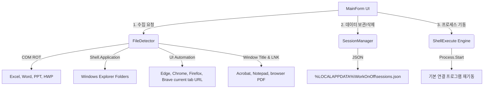

# WorkOnOff 아키텍처 개요 (ARCHITECTURE.md)

이 문서는 WorkOnOff 프로그램의 구조, 탐색 알고리즘, 세션 영속화 및 재실행 방식의 기술적 상세 내용을 다룹니다.

---

## 1. 전체 구조 (System Architecture)

본 프로그램은 C# .NET Framework 4.8 기반의 무설치 단일 폼 애플리케이션으로, Model-View-Controller 패턴과 유사하게 프레젠테이션(UI)과 핵심 유틸리티 레이어로 분리되어 있습니다.

---

## 2. 열린 파일 탐색 방식 (File Detection Mechanics)

보안 통제 및 프로세스 구조적 제약 문제를 극복하기 위해 다중 채널(Multi-Channel) 감지 방식을 수행합니다.

### A. COM 객체 기반 자동 탐색 (Office 및 한글)
- **원리**: COM 인터페이스의 Running Object Table(ROT) 및 Active Object 참조 모델을 사용합니다.
- **Excel (`Excel.Application`)**: `Workbooks` 컬렉션을 동적으로 순회하여 각 열려 있는 Workbook의 `FullName` 프로퍼티에서 로컬 절대 경로를 읽어옵니다.
- **Word (`Word.Application`)**: `Documents` 컬렉션을 순회하여 각 Document의 `FullName`을 읽어옵니다.
- **PowerPoint (`PowerPoint.Application`)**: `Presentations` 컬렉션을 순회하며 `Path`와 `Name`을 결합하여 절대 경로를 구성합니다.
- **한글 (`HWPFrame.HwpObject`)**: `XHwpDocuments` 컬렉션을 순회하여 각 활성 문서의 `FullName`을 획득합니다.
- **구현 특징**: 오피스 Interop DLL 종속성을 배제하기 위해 C#의 `dynamic` 지시어를 사용하여 런타임 Late Binding 방식으로 제어합니다. 해당 프로그램이 없어도 런타임 에러 없이 무시됩니다.

### B. Windows Shell API 기반 폴더 탐색 (탐색기)
- **원리**: Windows 셸 시스템 창 목록을 쿼리합니다.
- **기법**: `Type.GetTypeFromProgID("Shell.Application")`을 통하여 Shell 인스턴스를 구하고, `Windows()` 컬렉션을 받아옵니다.
- **경로 추출**: 창의 `FullName`이 `explorer.exe`인 윈도우 인스턴스를 필터링하고, `LocationURL` 프로퍼티를 Uri 클래스로 변환하여 로컬 디렉토리 경로(`C:\...`)를 복구해 냅니다.

### C. 브라우저 주소 표시줄(UI Automation) 탐색
- **대상**: Microsoft Edge, Google Chrome, Firefox, Brave, Internet Explorer의 화면에 표시된 브라우저 창입니다.
- **기법**: 표준 .NET Framework의 Windows UI Automation으로 브라우저 창 안의 주소 입력 컨트롤을 읽어, 현재 선택된 탭의 URL을 `Browser` 항목으로 저장합니다.
- **복원**: 저장 시 사용 중이던 브라우저 실행 파일로 해당 URL을 우선 실행하고, 브라우저가 제거된 경우에는 Windows 기본 브라우저로 열도록 폴백합니다.
- **보완 수단**: 보안 프로그램이나 브라우저 접근성 설정 때문에 주소를 읽지 못한 탭은 UI의 **[브라우저 URL 추가]** 버튼으로 직접 넣을 수 있습니다.

### D. 창 제목(Window Title) & 최근 문서(Recent LNK) 매칭 탐색 (PDF, 메모장 등)
- **문제점**: Adobe Reader, Chrome, Edge, 메모장은 문서 탐색용 표준 COM 인터페이스가 없거나 제한적입니다.
- **해결책**:
  1. 감시 프로세스 목록(`notepad`, `AcroRd32`, `Acrobat`, `msedge`, `chrome` 등)을 필터링하여 `MainWindowTitle`을 가져옵니다.
  2. 타이틀 문자열에서 정규식을 이용해 파일명(예: `통계자료.pdf`)을 안전하게 적출합니다.
  3. 적출한 파일명을 키로 하여 Windows의 최근 링크 경로 `%APPDATA%\Microsoft\Windows\Recent` 아래의 `.lnk` 파일 목록을 고속 스캔합니다.
  4. 매칭되는 단축아이콘이 발견되면 `Wscript.Shell` COM 객체를 생성하여 실제 파일 대상 경로(`TargetPath`)를 확보합니다.
  5. 최근 문서에 기록되지 않은 경우, 사용자의 3대 중요 디렉토리(바탕화면, 내 문서, 다운로드)를 1단계 깊이로 고속 탐색하여 실제 물리적으로 존재하는 파일을 대조 및 연동합니다.

---

## 3. 세션 저장 구조 (Session Storage Schema)

- **파일 포맷**: 표준 JSON 데이터 구조를 사용합니다.
- **사용 라이브러리**: C# .NET 4.8 `System.Web.Script.Serialization.JavaScriptSerializer`를 탑재하여 추가 외부 라이브러리 없이 순수 로컬 문자열 파싱과 직렬화를 고속으로 처리합니다.
- **세션 갱신 모델**: "현재 상태로 업데이트" 기능 수행 시 기존 Guid 키를 유지하면서 아이템 목록과 SavedAt 날짜 및 설명을 현 상태로 덮어쓰고, 최신순 목록으로 배열을 재구성하여 저장합니다.

---

## 4. 파일 재실행 방식 (Work Resumption Execution)

- **핵심 메커니즘**:
  - `System.Diagnostics.ProcessStartInfo`를 활용합니다.
  - `UseShellExecute = true` 옵션을 강제 적용하여, 특정 응용 프로그램의 설치 경로를 프로그램 내에 하드코딩하지 않고 Windows OS의 레지스트리에 등록된 기본 연결 프로그램(Default Association)을 통하여 파일이 열리도록 위임합니다.
- **예외 복원 안전판**:
  - 파일 실행 전 `File.Exists(path)` 및 `Directory.Exists(path)` 검사를 통해 파일 존재 유무를 먼저 검사합니다.
  - 파일이 존재하지 않거나 액세스 권한이 상실된 경우, 프로그램을 다운시키지 않고 오류 목록 컬렉션에 추가한 뒤 다음 루프로 넘어갑니다.
  - 전체 파일 실행 루프가 끝나면 한꺼번에 복원에 실패한 파일명 목록을 사용자에게 알리고, 로그에 원인을 기록합니다.
- **브라우저 URL**: 로컬 파일 존재 여부 대신 URL 형식만 확인한 뒤 실행합니다.
